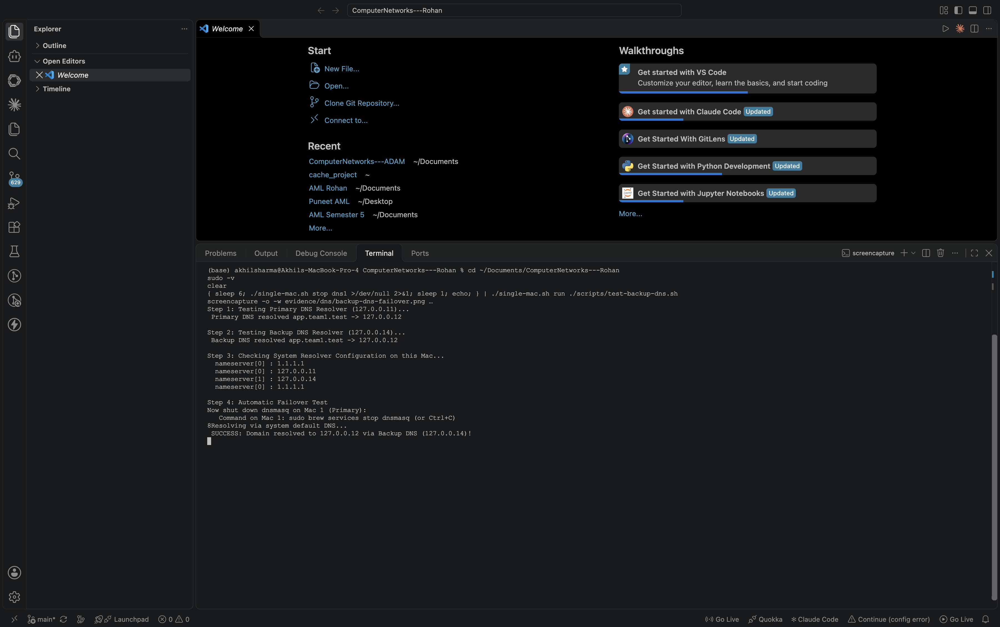
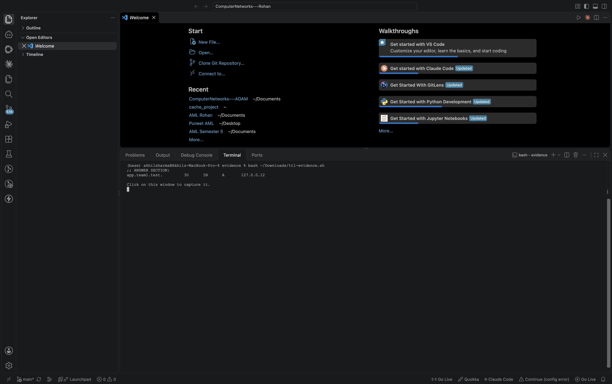
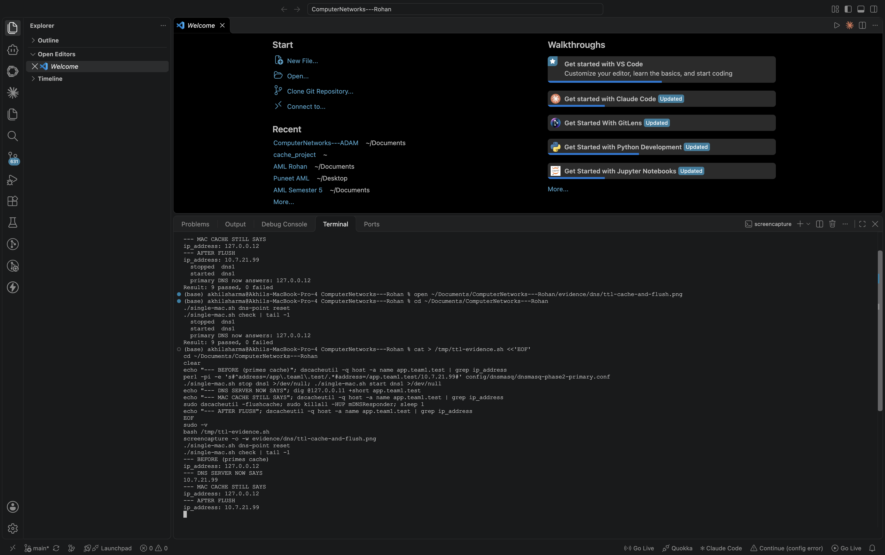
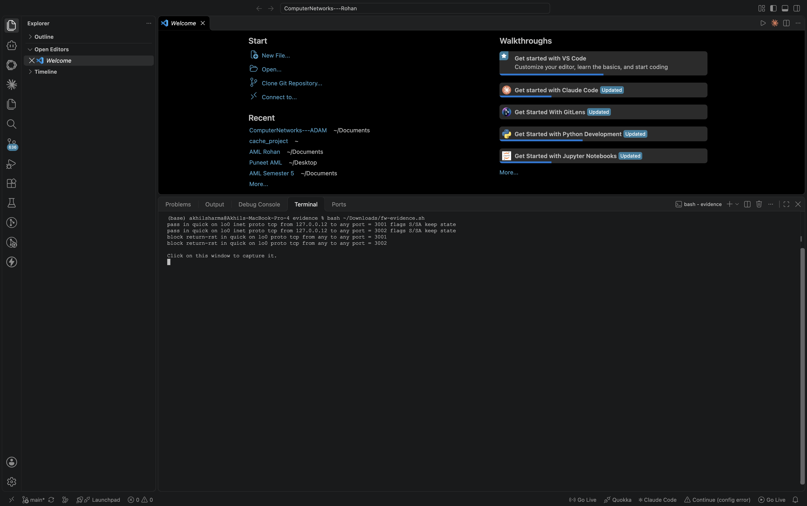
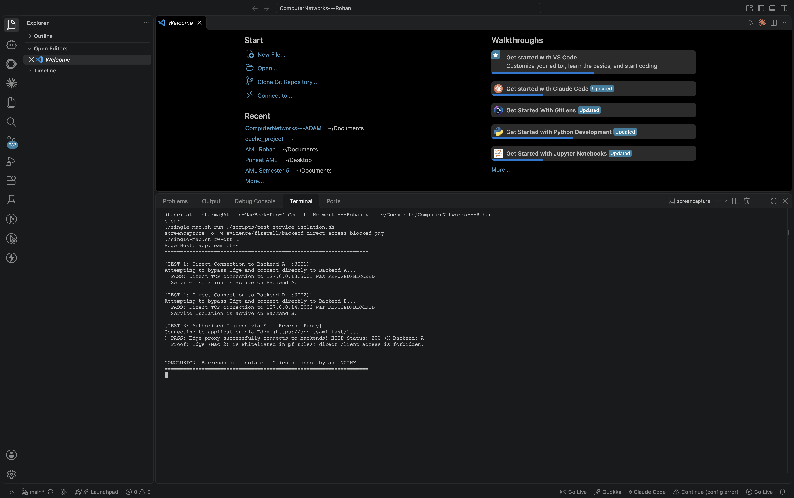
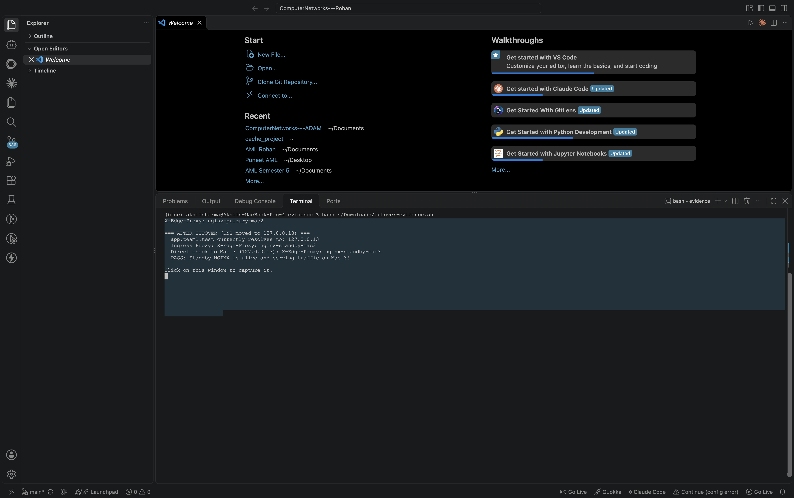
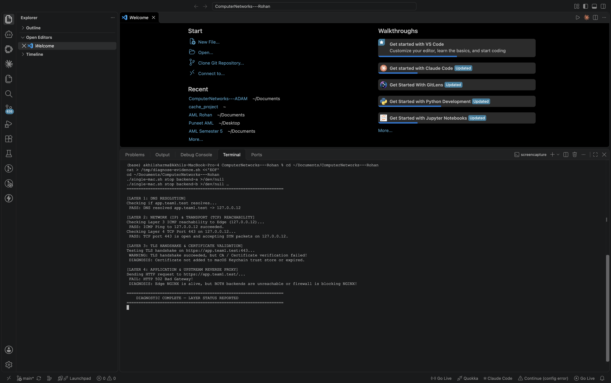
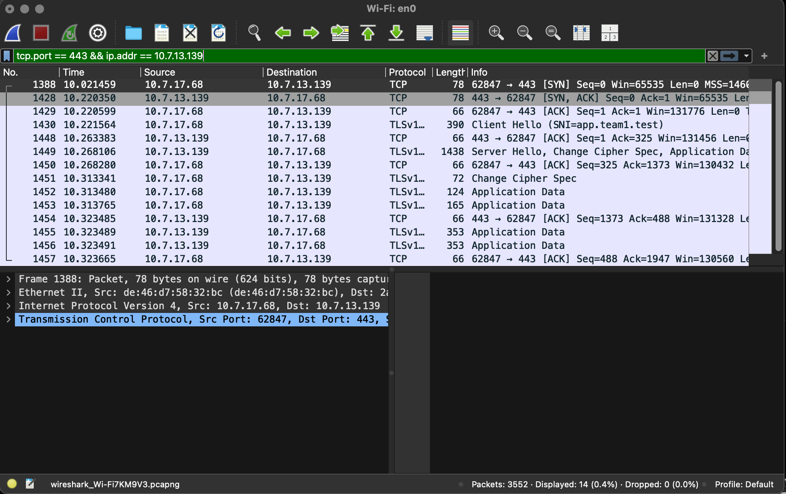
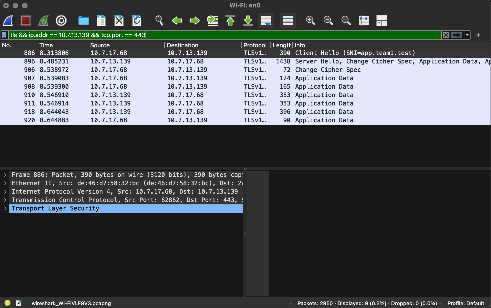
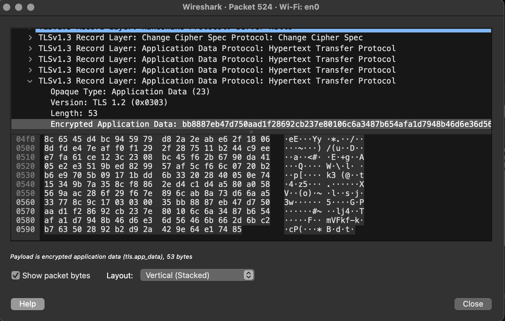

# Phase 2 Report: Single-Mac Private Network Service Platform

**Course:** Computer Networks, Private Network Service Platform
**Author:** Rohan (Roll No. 2401020103), individual submission
**GitHub:** https://github.com/rohannzzz
**Date of test run:** 26 November 2026

---

## Abstract

This report documents an individual implementation of Phase 2 (Extensions A to F) of the Private Network Service Platform. The platform normally runs on four laptops. Here, all four "machines" run on **one Mac**, each bound to its own loopback address in the `127.0.0.x` range, so DNS, the edge proxy, two backends, a backup DNS and a standby edge all coexist without port conflicts. A single control script, `single-mac.sh`, starts, stops and checks the whole stack. Every extension was run on this setup and its result is backed by a screenshot in `evidence/`. A final health check reports **9 passed, 0 failed**.

## 1. Basis and Scope

The topology, NGINX and dnsmasq configuration, backend application and diagnostic scripts come from the team project **Team Adam** (`manas-2212/ComputerNetworks---ADAM`). This repository is an individual adaptation of that project to a single machine.

| Item | Source |
|---|---|
| Four-node design, configs, backend app, test scripts | Team Adam (credited) |
| Single-Mac mapping (`single-mac.sh`, loopback addressing) | This submission |
| Test run, screenshots, results, this report | This submission |

Apart from the clearly labelled Wireshark captures in Section 5, screenshots from the original four-laptop run are **not** used as evidence here.

## 2. Architecture

Each former laptop is a loopback address on the same Mac.

| Role | Address | Service |
|---|---|---|
| Primary DNS ("Mac 1") | `127.0.0.11` | dnsmasq |
| Primary Edge ("Mac 2") | `127.0.0.12` | NGINX reverse proxy and load balancer (HTTPS :443, HTTP :80) |
| Backend A and Standby Edge ("Mac 3") | `127.0.0.13` | Node.js Express on :3001, standby NGINX on :443 (Extension E) |
| Backend B and Backup DNS ("Mac 4") | `127.0.0.14` | Node.js Express on :3002, backup dnsmasq on :53 (Extension A) |

```
CLIENT (macOS resolver)
   |  DNS :53
   v
PRIMARY DNS 127.0.0.11  (backup: 127.0.0.14)
   |  app.team1.test -> 127.0.0.12
   v
EDGE NGINX 127.0.0.12  (standby: 127.0.0.13)
   |  HTTPS :443, round-robin
   +--------------+
   v              v
BACKEND A 127.0.0.13:3001   BACKEND B 127.0.0.14:3002
```

**What this setup proves:** DNS resolution, TLS termination, reverse proxying, load balancing, caching headers, packet filtering and failover are all real, running software behaving as they would across machines.
**What it does not prove:** physical-network behaviour such as Wi-Fi latency, ARP between hosts, or real cross-host firewall traffic. All traffic here stays on the loopback interface.

## 3. Baseline Health Check

Command: `./single-mac.sh check`

| # | Check | Result |
|---|---|---|
| 1 | Primary DNS (`127.0.0.11`) answers | PASS |
| 2 | Backup DNS (`127.0.0.14`) answers | PASS |
| 3 | macOS resolver resolves `app.team1.test` | PASS |
| 4 | Backend A direct access (fails if firewall ON) | PASS |
| 5 | Backend B direct access (fails if firewall ON) | PASS |
| 6 | HTTPS via edge returns 200 | PASS |
| 7 | HTTP to HTTPS redirect (301) | PASS |
| 8 | Load balancing alternates A and B | PASS |
| 9 | `Cache-Control: max-age=60` on `/api/status` | PASS |

**Result: 9 passed, 0 failed.** The same result was confirmed again after a clean restart at the end of the run.

## 4. Phase 2 Extensions

### Extension A: Backup DNS Resolver Failover

**Objective:** keep name resolution working when the primary DNS server fails.
**Implementation:** a second dnsmasq instance on `127.0.0.14` serves the same records. The client resolver lists both servers.
**Result:** both servers answered `app.team1.test`. With the primary unavailable, the client resolved the name through the backup: `SUCCESS: Domain resolved to 127.0.0.12 via Backup DNS (127.0.0.14)`.
**Learning:** DNS redundancy depends on the client trying the second nameserver. Resolution continues with a short delay, not an outage.



### Extension B: DNS TTL and Cache Invalidation

**Objective:** show how TTL controls how long clients cache an answer.
**Implementation:** the record is served with a TTL of 30 seconds.
**Result:** `dig` shows `app.team1.test. 30 IN A 127.0.0.12`. After the record is changed on the server (to the dummy address `10.7.21.99`), the macOS cache can keep returning the old address until the TTL expires or the cache is flushed with `dscacheutil -flushcache` and `killall -HUP mDNSResponder`.
**Learning:** during a planned cutover, lower the TTL beforehand, then flush client caches if an immediate switch is needed.




### Extension C: Service Isolation (Backend Firewall)

**Objective:** backends must be reachable only through the edge proxy, never directly.
**Implementation:** macOS `pf` rules on ports 3001 and 3002: two `pass in quick` rules allowing only `127.0.0.12`, and two `block return-rst` rules for everyone else.
**Result:** with the firewall on, a direct connection to Backend A (:3001) and Backend B (:3002) is refused, while access through the edge returns `HTTP Status: 200`. All three tests passed.
**Learning:** the packet filter enforces the architecture at Layer 4, so even a client that knows the backend address cannot bypass the proxy.




### Extension D: High-Availability Failover

**Objective:** the service should survive the loss of one backend with no visible errors.
**Implementation:** NGINX passive failure detection (`proxy_next_upstream`) across the two-backend pool.
**Result:** requests first alternated between A and B. After Backend A was stopped, all 10 test requests were served by Backend B with `Status = 200` and no 502 errors. Starting Backend A again restored round-robin.
**Learning:** the proxy retries the next upstream within the same request, so the client never sees the failure.


### Extension E: Controlled Edge Migration (DNS Cutover)

**Objective:** move traffic from the primary edge to a standby edge in a controlled way.
**Implementation:** a standby NGINX instance on `127.0.0.13` serving the same site, plus a DNS record change from `127.0.0.12` to the standby address.
**Result:** before cutover the response header was `X-Edge-Proxy: nginx-primary-mac2`. After cutover it was `X-Edge-Proxy: nginx-standby-mac3`, with `PASS: Standby NGINX is alive`. The primary was restored afterwards and the health check returned 9 of 9.
**Learning:** a response header that identifies the serving edge makes a migration easy to prove, and the TTL from Extension B governs how fast clients follow.



### Extension F: Systematic Troubleshooting

**Objective:** diagnose an injected fault layer by layer instead of guessing.
**Fault injected:** both backends stopped.
**Tool:** `scripts/diagnose-stack.sh`, a four-layer ladder: DNS, network and port, TLS, application.

| Layer | Check | Result |
|---|---|---|
| 1 | DNS resolution | PASS |
| 2 | Network reachability and TCP port 443 | PASS |
| 3 | TLS handshake and certificate | Certificate warning (expected, local test certificate) |
| 4 | Application and upstream backends | **FAIL: HTTP 502 Bad Gateway** |

**Diagnosis:** Layers 1 to 3 are healthy, so the fault is at the application layer. The edge is up but has no live upstream. **Fix:** restart the backends, then re-run the check (confirmed: 9 passed, 0 failed).



## 5. Packet-Level Evidence (Wireshark)

> **Source note:** these captures come from the original four-laptop run by Team Adam, not from this single-Mac setup, so they show LAN addresses instead of loopback addresses. They are included to illustrate the same protocol behaviour (TCP, TLS) that this setup uses.





## 6. Summary

| Extension | Topic | Status | Evidence |
|---|---|---|---|
| A | Backup DNS | Completed | `evidence/dns/backup-dns-failover.png` |
| B | DNS TTL and cache | Completed | `evidence/dns/ttl-30s-countdown.png`, `ttl-cache-and-flush.png` |
| C | Service isolation (pf) | Completed | `evidence/firewall/` (2 files) |
| D | HA failover | Completed | `evidence/failover/backend-a-down-failover-to-b.png` |
| E | Edge cutover | Completed | `evidence/cutover/standby-edge-cutover-header.png` |
| F | Troubleshooting | Completed | `evidence/troubleshooting/diagnose-stack-4layers.png` |

## 7. Limitations

1. All "machines" share one operating system and one network stack, so this is a functional simulation, not a physical four-node network.
2. Packet filtering was tested on the loopback interface only.
3. The Layer 3 certificate warning comes from a locally generated test certificate.
4. The Wireshark captures are from the original four-laptop run (credited), not from the single-Mac setup.
5. Firewall and standby edge were turned off after each demo; they are not claimed to be continuously active.

## 8. Conclusion

The full Phase 2 feature set (redundant DNS, TTL control, service isolation, high availability, edge migration and layered troubleshooting) was run on a single Mac using loopback addressing, and the final health check passes 9 of 9. The work shows that the service behaviour does not depend on four separate laptops, while the limitations above show where a physical deployment would still add value.

## References

- Team Adam, *ComputerNetworks---ADAM* (base architecture and scripts): https://github.com/manas-2212/ComputerNetworks---ADAM
- NGINX documentation: `proxy_next_upstream`, `upstream` module
- dnsmasq manual
- macOS `pfctl(8)` manual page
